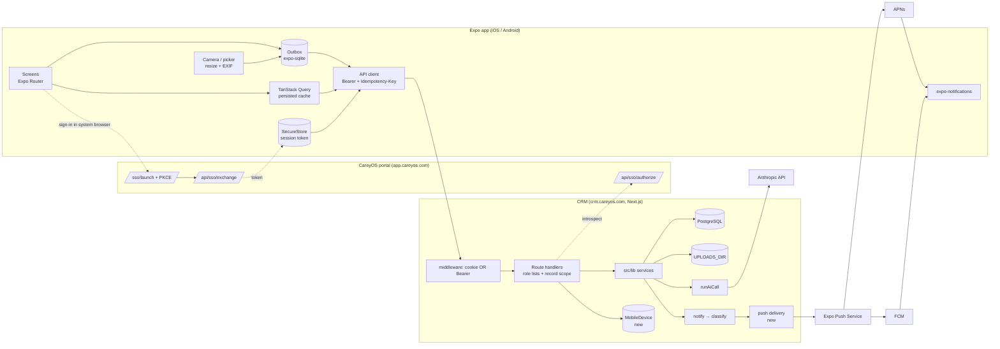

# CareyOS Construction CRM — Mobile App (iOS + Android)

_Planning document, 2026-11-08. Nothing has been built. Approving this document authorises Phase 0 and Phase 1 only (§G); each later phase is approved on its own, as the CRM's other workstreams have been._

Conventions used below: **[repo]** means confirmed by reading the code (a file path is given). **[assumed]** means not yet verified; Phase 0 checks it. Paths are relative to the CRM repo root unless they start with `~/careyos` (the CareyOS portal).

---

## A. Executive recommendation

**Build a native Expo (React Native + TypeScript) app as a thin client of the existing CRM API.** No second backend, no second database, no second permission system. The phone calls the same route handlers the web app calls, so each route's role list and record scope apply unchanged.

**Why this is cheaper than it looks.** The CRM already has a field mode (`src/app/(field)/field/*` [repo]): Today, Jobs, Tasks, task detail with checklist and photo, daily logs with labor check-in/out, weather, signature, submit/approve and PDF, field issues, and photo upload with capture-time EXIF. The backend for a field MVP is already written. What it lacks is a native shell, which brings three things a browser tab on a phone does badly:

1. **Reliable photo capture and upload** from a jobsite with weak signal: a queue that survives the app being closed, plus retries.
2. **Push notifications** (the CRM today notifies by email digest and an in-app bell only).
3. **A sign-in that lasts.** The web session lives in a `.careyos.com` cookie, which the phone's browser can lose.

**The one real backend gap is authentication.** The CRM authenticates only by forwarding the `careyos_session` cookie to the portal (`src/lib/sso.ts introspect()` [repo]). The portal already has a cross-domain handoff (`~/careyos/app/sso/launch/route.ts` → `~/careyos/app/api/sso/exchange/route.ts` [repo]) that returns a 7-day session token. The mobile app reuses it, with PKCE added and a mobile callback registered.

**Proposed MVP (the smallest release people will use every day):**
- sign-in;
- My Day;
- My Jobs, with a job card offering call, directions, documents and photos;
- Tasks: Done, notes, blocker, photo;
- camera to job, task or issue, through an offline upload queue;
- job documents with a PDF viewer;
- push notifications for assignment, due today, and an inspection tomorrow;
- the daily log narrative with photos and submit.

**The labor sheet and the full offline cache come in Phase 3.**

**Phase 0 usage check (prod, read-only, 2026-11-08; run by Richard).**
- **Users:** 7 active: 5 ADMIN, 1 MANAGER, 1 CREW_LEAD.
- **Last 60 days:**
  - 1 daily log, 0 daily-log photos, 0 field issues;
  - 94 tasks completed: 92 assigned to ADMINs, 2 to the MANAGER, 0 to the crew lead.

The web field mode is almost unused, and the CRM's day-to-day work is done by the office and admin users. **Re-scope approved by Richard (2026-11-08):** the MVP centres on what those users already do: Today, Tasks, push, Jobs, photos and documents. The daily log narrative moves from P0 to Phase 3. No crew accounts are created yet (Richard, 2026-11-08): the pilot is office and admin users plus the one crew lead, and is measured by the share of task updates made from the phone.

**Phase 0 sign-in test (2026-11-08): passed on Richard's iPhone.** Expo Go reached the Mac over Tailscale.
- Portal changes are on branch `mobile-pkce` in `~/careyos`; CRM changes are on branch `mobile-spike` (worktree). Neither is committed or deployed.
- Results: the exchange with the code verifier returned 200 and without it 401; the CRM's `/api/me` with the Bearer token returned 200; the scripted check passed 16/16.
- Fixed on the way: a mistyped portal password dropped the return path, so the person landed on the portal dashboard instead of back in the app.

**Major risks:**
- **Too few users.** Around 8 CRM users, and the field crew may be 1–3 people [assumed, CLAUDE.md record]. A store app is worth building only if the crew will use it daily. Phase 0 measures current `/field` usage on prod first, and the pilot (§13) decides whether to go wide.
- **Authentication changes span two repos** (the CRM and the portal).
- **Photos are stored on the droplet's own disk**, and backed up on the same droplet.
- **App-store accounts and signing** are an operator burden.

**Effort to a pilot of the MVP:** about 6–7 engineer-weeks (Phases 0–2), assuming one engineer, the backend as it is today, and Richard testing on real devices.

---

## B. Existing application audit

### B.1 Technology architecture

| Area | Finding | Evidence |
|---|---|---|
| Frontend | Next.js 16.2.3 App Router, React 19.2.4, TanStack Query 5, Base UI / shadcn components | `package.json`, `src/app` |
| Backend | Next.js route handlers, about 140 handlers in some 80 groups under `src/app/api`; services in `src/lib/**` | `src/app/api/*` |
| Database | PostgreSQL through Prisma 7 (generated client in `src/generated/prisma`) | `prisma/schema.prisma` |
| Auth | CareyOS SSO: the `careyos_session` cookie is forwarded as a Bearer token to `app.careyos.com/api/sso/authorize` on every request; the CRM keeps its own `User` row and a second active flag | `src/lib/sso.ts`, `src/lib/auth/helpers.ts`, `src/middleware.ts` |
| Permissions | Seven roles (ADMIN, MANAGER, OFFICE_STAFF, SALES_REP, MARKETING, READ_ONLY, CREW_LEAD), explicit role lists per route, record scope for own-only roles; a test fails on any handler that checks only the session | `src/lib/access/roles.ts`, `src/lib/access/records.ts`, `src/lib/money/access.ts`, `src/app/api/route-guards.test.ts` |
| Files | Local disk at `UPLOADS_DIR` (`/var/lib/knuco/uploads` on prod), served through the authorised `/api/files/[id]`; there are no signed URLs | `src/lib/files/storage.ts`, `src/app/api/files/[id]/route.ts` |
| Calendar | One date axis on `Task` (`dueAt`, `scheduledStart`, `allDay`); `/api/calendar` with read-only overlays (inspections, hearings, job starts, install dates) | `src/lib/calendar/*`, `src/app/api/calendar/route.ts` |
| Notifications | Notifications v2: `notify()` → classify → immediate email or digest; bell rows; per-user preferences; shadow mode on prod | `src/lib/notifications/*` |
| AI | Shared layer `runAiCall` (zod-checked, capped per subject and per month, audited as `AiCall`, untrusted-document framing); Anthropic SDK | `src/lib/ai/*` |
| CareyOS links | SSO; CareyOS Work integration over Bearer `WORK_API_KEY`; cc-allocator postings | `src/app/api/integrations/*` |
| Background jobs | Cron wrappers on the droplet calling `/api/cron/*` with `CRON_SECRET`; `after()` for in-request AI work; a table-driven tick queue for plan takeoff | `src/app/api/cron/*`, `src/lib/takeoff/pipeline/*` |
| Deploy | `deploy.sh` rsyncs the repo to `/opt/knuco`, then migrate, build and restart the systemd unit `knuco`; there is no CI | `deploy.sh` |
| Tests | Vitest (around 1,950 tests); headless-Chromium QA scripts run by hand per stage; no CI and no committed end-to-end suite | `vitest.config.ts` |
| Offline today | An IndexedDB draft store for the labor sheet only, with a `baseUpdatedAt` concurrency token | `src/lib/field-store.ts`, `src/app/api/jobs/[id]/daily-logs/[date]/route.ts` |

### B.2 Modules (status as they bear on mobile)

| Module | Status | Mobile-relevant routes |
|---|---|---|
| Jobs / projects | Implemented | `/api/jobs` (`scope=mine`, the involvement rule), `/api/jobs/[id]`, `/overview`, `/gallery` |
| Tasks | Implemented (notes, watchers, nudge, dependencies, workflow evidence) | `/api/tasks`, `/api/tasks/[id]`, `/notes`, `/summary`, `/bulk` |
| Workflow steps | Implemented (ordinary tasks; Complete dialog; gates) | through `/api/tasks/[id]`, `/api/jobs/[id]/workflow` |
| Calendar | Implemented | `/api/calendar`, `/api/calendar/unscheduled` |
| Field mode | Implemented as a web shell | `/api/field/today` (office roles and CREW_LEAD; **not SALES_REP**) |
| Daily logs + labor | Implemented (labor, check-in/out, weather, signature, submit, return, approve, PDF, email) | `/api/jobs/[id]/daily-logs/[date]/**` |
| Photos | Implemented: daily-log `FieldPhoto` plus image `File`s, merged into one gallery | `/api/jobs/[id]/photos`, `/api/jobs/[id]/gallery`, `/api/photos/[id]/**`, `/api/files` |
| Field issues / punch | Implemented (on the daily log) | `/api/jobs/[id]/field-issues`, `/api/field-issues/[id]` |
| Permits + inspections | Implemented (the permit record, inspections, corrections, preflight) | `/api/jobs/[id]/permits`, `/api/permits/[id]`, `/api/inspections` |
| Product approvals | Implemented | `/api/product-approvals` |
| Plans / drawings | Implemented (plan sets, sheet viewer, takeoff) | `/api/plan-sets`, `/api/plan-sheets/[id]` |
| Documents | Implemented (job files, preview, the vault) | `/api/files?jobId=`, `/api/files/[id]` |
| Change orders | Implemented (office) | `/api/jobs/[id]/change-orders` |
| Estimates / budgets | Implemented (office) | `/api/jobs/[id]/budget`, `/cost-summary` |
| Crew payments | Implemented (requests + completion photos) | `/api/labor-payment-requests/[id]` |
| Vendors / commitments | Implemented (office) | `/api/vendors` |
| Material purchasing / RFQ | Planned (plan-takeoff M6) | none |
| Time tracking (individual) | Partial: crew check-in/out sits on the daily log labor rows; there is no personal clock | `/labor/[entryId]/check-in` |
| Equipment, safety checklists | Absent | none |
| Push notifications | Absent | none |
| Voice input | Absent | none |
| Mobile auth (Bearer from a device) | Absent | none |

### B.3 What the mobile app reuses as it is

Every route in §F.1 below. Also reused unchanged:
- the role lists and record scopes;
- `taskRightsFor` (who may work a step);
- `applySchedule`, the one date rule;
- the photo `takenAt` handling;
- the notification kinds and classification;
- `runAiCall`.

The mobile app re-implements **no** business rule. Gates, evidence checks and money rules are enforced by the server, and the app shows the server's refusal as it is.

### B.4 Dependency map



---

## C. Feature prioritisation matrix

Weights: frequency 25 %, operational value 20 %, field urgency 20 %, backend reuse 15 %, ease 10 %, automation 10 %. Each criterion is scored 1–5. **Override** marks a feature placed by a dependency or a security need rather than by its score.

| # | Feature | Freq | Value | Urg. | Reuse | Ease | Auto | **Score** | Tier |
|---|---|---|---|---|---|---|---|---|---|
| 1 | My Day (today, overdue, inspections, job starts) | 5 | 5 | 5 | 5 | 4 | 3 | **4.70** | P0 |
| 2 | Camera → photos on a job, task or issue (queued upload) | 5 | 5 | 5 | 4 | 3 | 3 | **4.45** | P0 |
| 3 | Task: Done, status, notes, blocker | 5 | 5 | 4 | 5 | 4 | 2 | **4.40** | P0 |
| 4 | My Jobs + job card (address, contacts, call, directions) | 5 | 4 | 5 | 5 | 4 | 1 | **4.30** | P0 |
| 5 | Daily log: narrative, photos, submit | 4 | 5 | 4 | 5 | 2 | 4 | **4.15** | **P1, Phase 3** (re-scoped after the usage check: 1 log in 60 days) |
| 6 | Push notifications | 4 | 4 | 5 | 4 | 3 | 3 | **4.00** | P0 |
| 7 | Field issues / punch items | 3 | 4 | 4 | 5 | 3 | 3 | 3.70 | P1 |
| 8 | Sign-in (SSO + PKCE), biometric unlock | 5 | 4 | 4 | 3 | 3 | 1 | 3.70 | **P0, override** |
| 9 | Job documents + PDF viewer (plans, permits, NOAs) | 4 | 4 | 4 | 4 | 3 | 1 | 3.60 | P0 |
| 10 | Inspections: list, result, corrections | 2 | 4 | 4 | 5 | 3 | 4 | 3.55 | P1 |
| 11 | Voice → task / voice → daily log (AI) | 3 | 4 | 4 | 3 | 2 | 5 | 3.50 | P1 (Phase 4) |
| 12 | Create a follow-up task | 3 | 3 | 3 | 5 | 4 | 3 | 3.40 | P0 (simple form) |
| 13 | Offline: cached reads + queued writes | 4 | 4 | 5 | 2 | 2 | 1 | 3.40 | **P0 for the photo / status / note queue (override); P1 for full read cache** |
| 14 | Workflow step checklist + Complete dialog | 3 | 3 | 3 | 5 | 3 | 2 | 3.20 | P1 |
| 15 | Calendar day / week | 3 | 3 | 3 | 5 | 3 | 1 | 3.10 | P1 |
| 16 | Owner summary (attention rows + owner strip) | 2 | 4 | 2 | 5 | 4 | 2 | 3.05 | P2 |
| 17 | Crew payment request + completion photos | 2 | 3 | 2 | 5 | 3 | 2 | 2.75 | P2 |
| 18 | AI project assistant (Q&A) | 2 | 3 | 2 | 3 | 2 | 5 | 2.65 | P3 |
| 19 | Change order request from site | 1 | 3 | 3 | 4 | 3 | 2 | 2.55 | P2 |
| 20 | AI photo tagging / progress text | 2 | 2 | 2 | 3 | 2 | 5 | 2.45 | P3 |
| 21 | Personal time tracking | 2 | 3 | 3 | 2 | 2 | 2 | 2.40 | P2 (needs a payroll ruling) |
| 22 | Material requests / delivery confirmation | 2 | 3 | 3 | 1 | 2 | 3 | 2.35 | P3 (waits on the takeoff RFQ) |
| 23 | Safety inspections / checklists | 2 | 3 | 3 | 1 | 2 | 2 | 2.25 | P3 |
| 24 | Drawing annotation / takeoff on the phone | 1 | 2 | 2 | 3 | 1 | 2 | 1.80 | P3 (stays on desktop) |

**Challenged, and not proposed:**
- equipment tracking (KNU holds no equipment records today);
- a mobile estimate builder (an office task, with dense tables);
- the full admin surface;
- mobile drawing markup;
- AI deficiency detection "as an inspection" (it can never stand in for an inspector).

### C.1 Feature cards (P0)

Each card gives: who it is for · the problem · how often · backend support · backend change · UI complexity · offline · automation · dependencies · effort · acceptance criteria · phase.

1. **Sign-in.**
   - **For / problem / how often:** every user; the web cookie is lost on phones; once a week.
   - **Backend support:** the portal handoff exists.
   - **Backend change:** PKCE + a mobile callback (portal); Bearer in `introspect` + middleware; `MobileDevice` (CRM).
   - **UI / offline / automation / dependencies:** low UI; offline: the app opens on cached data until the token expires; no automation; no dependencies.
   - **Effort:** 4 d.
   - **Acceptance:** sign in with the CareyOS account in the system browser and land on My Day; a revoked grant or a revoked device gets 401 on the next request; sign-out wipes the token, cache and outbox (after warning about unsent items).
   - **Phase:** 1.
2. **My Day.**
   - **For / problem / how often:** crew, PMs, superintendents; "what do I do now"; many times a day.
   - **Backend support:** `/api/calendar?from=today&to=today&users=me` (with overlays) plus `/api/tasks?overdue&assignedUserId=me`.
   - **Backend change:** none. A `GET /api/mobile/my-day` aggregator is optional, if the round trips prove slow.
   - **UI / offline / automation / dependencies:** medium UI; offline: last copy shown with "as of 7:42"; no automation; depends on sign-in.
   - **Effort:** 3 d.
   - **Acceptance:** the counts equal the web's `/field/day` for the same user and day; Done from the card updates the web within one refresh.
   - **Phase:** 2.
3. **My Jobs + job card.**
   - **Backend support / change:** `/api/jobs?scope=mine&excludeClosed=1` and `/api/jobs/[id]/overview`; no change.
   - **Offline:** the last 30 jobs are cached.
   - **Acceptance:** a SALES_REP sees only their involved jobs (the same list as the web's Mine); Call and Directions hand off to the phone and maps apps; the money section shows only what `jobMoneyView` allows.
   - **Effort:** 3 d.
4. **Tasks.**
   - **Backend support:** `/api/tasks` and `/api/tasks/[id]` (PATCH status, notes, blocker) and `/notes`.
   - **Backend change:** an `Idempotency-Key`; an optional `baseUpdatedAt`.
   - **Acceptance:** Done, Blocked (with a reason) and a note sync to the web; a gated step shows the server's evidence refusal and offers Photo; a task changed on the web while the phone was offline is never overwritten silently (§F.4).
   - **Effort:** 4 d.
5. **Camera + photo queue.**
   - **Backend support:** `POST /api/files` (with `jobId` / `taskId` / `fieldIssueId`) and `/api/jobs/[id]/photos` for daily-log photos.
   - **Backend change:** `Idempotency-Key` on both; `takenAt` accepted from the client when the image's EXIF has been removed by resizing.
   - **Acceptance:** 10 photos taken in airplane mode upload once signal returns, each exactly once, with the capture time kept and no GPS stored (the server strips location); median upload ≤ 15 s on LTE.
   - **Effort:** 5 d.
6. **Documents.**
   - **Backend support / change:** `/api/files?jobId=` and `/api/files/[id]`; no change.
   - **Acceptance:** a 20 MB plan PDF opens and pinch-zooms on both platforms; "Keep on this phone" stores it in the app sandbox only; sign-out deletes it.
   - **Effort:** 3 d.
7. **Push.**
   - **Backend support:** Notifications v2 kinds and classification.
   - **Backend change:** a push delivery channel; `MobileDevice.pushToken`; a per-user "Phone" preference.
   - **Acceptance:** an assignment arrives as one push (never also as an immediate email when the person has push on); tapping it opens the task; the body names the job address and kind, and never money or customer details.
   - **Effort:** 4 d.
8. **Daily log (narrative + photos + submit).**
   - **Backend support / change:** `/api/jobs/[id]/daily-logs/[date]` (PUT with `baseUpdatedAt`) and `/submit`; no change.
   - **Acceptance:** a draft survives the app being killed; submit refuses with the server's reason when required fields are missing.
   - **Effort:** 4 d.

P1 and P2 cards follow the same pattern and are written into the tickets when their phase is approved.

---

## D. Mobile architecture specification

### D.1 Technology choice

| Option | Reuse of TypeScript / zod / React Query | Camera + background upload | Push | Offline | Store deployment | Verdict |
|---|---|---|---|---|---|---|
| **Expo (managed, dev client, EAS)** | High: same language, zod contracts shared | expo-camera, expo-image-manipulator, expo-file-system background upload | expo-notifications (APNs / FCM) | expo-sqlite | EAS Build / Submit / Update | **Recommended** |
| Bare React Native | Same | Same, but configured by hand | Same | Same | Fastlane by hand | More work, no gain |
| Flutter | None (Dart) | Good | Good | Good | Good | Rewrites every contract |
| PWA (improve `/field`) | Total | iOS: no background upload; camera limited to file input | iOS 16.4+ web push only after "Add to Home Screen" | IndexedDB, can be evicted | None | The fallback if usage is too low (§H) |

**Versions** (current stable on 2026-11-08, per `npm view`):
- Expo SDK 58, with the React Native version that SDK pins (0.88.x), installed only through `npx expo install` so the versions match one another;
- expo-router 58, TanStack Query 5.107, expo-sqlite 58, expo-secure-store 58, expo-notifications 58, expo-camera 58;
- `@sentry/react-native` 8;
- PDF: `react-native-pdf` (needs a development build, not Expo Go);
- list virtualisation: `@shopify/flash-list`.

No other library is added without a stated need. Nothing web-only (Base UI, Tailwind DOM, react-pdf/renderer) is imported into the app.

### D.2 Repository layout

```
mobile/                      Expo app (own package.json, own lockfile)
  app/                       Expo Router screens
  src/api/                   fetch client, Bearer, Idempotency-Key, error mapping
  src/outbox/                SQLite queue + runner
  src/auth/                  PKCE flow, SecureStore
src/lib/mobile-api/          pure zod request/response contracts (no Prisma, no Next),
                             imported by route handlers and by mobile/ via a path alias
```

`deploy.sh` gains `--exclude=/mobile/`, and the rsync is dry-run first: the uploads lesson (2026-10-02) says to dry-run every change to that rsync. The web build ignores `mobile/` (tsconfig `exclude`).

### D.3 Authentication

1. The app generates `code_verifier` and opens the system browser (ASWebAuthenticationSession on iOS, Custom Tabs on Android) at `app.careyos.com/sso/launch?app=construction-crm&client=mobile&code_challenge=…`.
2. The portal signs the person in (or reuses the browser's portal session), checks the grant live, and redirects to the **registered** callback `knuco://auth?sso=<handoff>`. The handoff token carries the `code_challenge`.
3. The app POSTs the handoff and the `code_verifier` to `/api/sso/exchange` and receives the ordinary 7-day session token. **A mobile handoff without a matching verifier is refused**, so a handoff token caught by another app on the same scheme is useless.
4. The token is kept in SecureStore (Keychain / Keystore, this-device-only). Every CRM request carries `Authorization: Bearer <token>`.
5. On the CRM side, `introspect()` reads the cookie, else the Bearer header. Middleware lets a Bearer request through to `/api/*` (page routes still require the cookie). On the first sign-in the app registers a `MobileDevice` (installation id, platform, app version, push token, `sha256(token)`).
6. Requests whose token hash belongs to a revoked device get 401. Admin → Users gains "Phones" with Revoke. Turning a person off in CareyOS or in the CRM works as it does today.
7. **Expiry.** There is no refresh token: after 7 days the app re-runs step 1, which is usually one tap because the browser still holds the portal session. Queued writes wait and are sent after re-authentication, and only if the same user signs in again.
8. **Biometric unlock** (expo-local-authentication) is a local lock on opening the app after 15 minutes in the background. It is not authentication, and it is optional per user.

Changes are needed in both repos. The portal's live grant check stays the single source of authorisation, and nothing new is trusted.

### D.4 Push

- **Path:** Notifications v2 gains a `push` delivery channel. A kind marked immediate, for a person with push on and a live device, goes to the Expo Push Service (which delivers through APNs and FCM). Digests are unchanged.
- **Dedupe:** the existing `Notification.dedupeKey` prevents a push and an immediate email for the same event (the person picks Phone or Email per category).
- **Content:** kind + job address, for example "New task — 3310 NE 37 St". No money, no customer names or phones. The app fetches the rest after opening.
- **Failure handling:** invalid tokens reported by Expo receipts mark the device's push off.
- **Deep links:** `knuco://tasks/<id>`, `knuco://jobs/<id>`, built from `src/lib/notifications/links.ts`.

---

## E. Screen inventory and UX specification

**Navigation:**
- Four tabs plus a centre action button: **Today · Jobs · (＋) · Tasks · More**.
- Calendar lives inside Today as a day strip and week toggle, rather than as its own tab, because field users think "today", and a fifth content tab would leave the action button with no slot.
- (＋) opens a sheet: **Photo · Task · Daily log · Issue · Document**. It is contextual: inside a job it pre-fills that job.
- More holds: Calendar (week), Notifications, Upload queue, Settings, Sign out.

**Design rules:**
- 48 pt minimum touch targets; one primary action per card.
- High-contrast theme, legible in sun; system dark mode supported.
- Address first everywhere (the CRM's `jobLabel` rule); no tables.
- A sync badge in the header: ✓ synced · ↻ n waiting · ⚠ n need attention.
- Every list has empty, loading and error states. A refusal shows the server's sentence.

| Screen | Wireframe description |
|---|---|
| Sign-in | Logo, "Sign in with CareyOS" button, help line. After sign-in: an optional prompt to enable Face ID / fingerprint, and a prompt to allow notifications explaining what will be sent. |
| Today | Greeting + date; a ‹ day › strip; an overdue callout (red, count); cards in time order (time rail, address, title, badges); a row of large buttons on each card: Done · Photo · Directions · Call · More. Overlays (inspections, job starts, installs) appear as dashed cards with no Done. "Done · n" folds at the bottom. Pull to refresh; "as of" stamp when offline. |
| Jobs | Search; Mine list (address, customer, stage pill, open task count). |
| Job | Header: address, customer, Call, Directions. Segments: **Overview** (stage, PM, next inspection, open tasks) · **Tasks** · **Photos** (grid, newest first; ＋ camera) · **Docs** (grouped by category; tap opens the PDF viewer; ⋯ Keep on this phone) · **Log** (today's daily log). |
| Task | Title, job address, due, owner; checklist (when a workflow step); Notes thread with a composer; attachments strip; bottom bar: **Done** (or Complete… when evidence is required) · Blocked… · Photo. Blocked asks for a reason (a required field). |
| Camera | Native camera; multi-shot with a thumbnail tray; "Attach to:" chip (job / task / issue, pre-filled from context); an optional caption and tag (room / phase); Save queues every photo at once. |
| Upload queue | Each item: thumbnail, target, state (waiting / sending n % / sent / needs attention + reason, with Retry or Move to job). |
| Daily log | Date; Work performed (text, with voice from Phase 4); Delays; Tomorrow's plan; weather (auto-filled by the existing route); photos; Submit. The labor rows come in Phase 3. |
| New task | Title; job (pre-filled); assignee (assignable users); due (Today / Tomorrow / pick); priority; photo. |
| Issue (Phase 3) | Photo first, then description, location (job area), assignee, due. |
| Notifications | The bell list (`/api/notifications`), tap to open, mark all read. |
| Settings | Notifications per category (Phone / Email / Off, mirroring Notifications v2 preferences), biometric lock, storage used, clear cached documents, app version, sign out. |

**Core journeys and their targets:** take a progress photo (3 taps); mark the task done (2 taps from Today); report a blocker (3 taps + a reason); open the permit before an inspection (3 taps); submit the day's log (≤ 2 minutes).

---

## F. API and data synchronisation plan

### F.1 Endpoints the app reuses

| Operation | Route | Auth / scope | Offline behaviour |
|---|---|---|---|
| Me + role + preferences | `GET /api/me`, `PATCH /api/me/preferences` | session | cached |
| Today | `GET /api/calendar`, `GET /api/tasks` (filters `assignedUserId`, `dueTo`, overdue) | visibility scope as on the web | cached, stamped |
| Field jobs | `GET /api/field/today` (CREW_LEAD / office) or `GET /api/jobs?scope=mine` (everyone; **this is the one the app uses**) | `jobAccessWhere` | cached (30 jobs) |
| Job | `GET /api/jobs/[id]`, `/overview`, `/gallery` | `guardJob` + `redactJobMoney` | cached when opened |
| Tasks | `GET/PATCH /api/tasks/[id]`, `GET/POST /api/tasks/[id]/notes`, `POST /api/tasks` | `taskRightsFor`, `guardJob` | PATCH / notes / POST queued |
| Assignable users | `GET /api/users/assignable` | session | cached |
| Files | `GET /api/files?jobId=`, `GET /api/files/[id]`, `POST /api/files` (multipart) | `fileReadWhere`, `canDeleteFile` | POST queued; GET kept on request |
| Daily-log photos | `GET/POST /api/jobs/[id]/photos` | `guardJob` | POST queued |
| Daily log | `GET/PUT /api/jobs/[id]/daily-logs/[date]` (`baseUpdatedAt`), `POST …/submit`, `…/weather` | the field roles | draft saved locally; PUT and submit queued |
| Field issues | `GET/POST /api/jobs/[id]/field-issues`, `PATCH /api/field-issues/[id]` | `guardJob` | POST queued |
| Inspections | `GET /api/inspections`, `PATCH /api/inspections/[id]` | `guardJob` | read cached; result needs a connection |
| Bell | `GET /api/notifications`, `/unread-count`, `/[id]/read`, `/read-all` | session | cached |

Pagination follows each route as it is today (`take` / cursor where present). Errors follow the existing `{ error, hint? }` shape. The app maps 401 to re-authentication, 403 / 404 to "not available to you", 409 to a conflict, 422 / 400 to a field message, and 5xx to a retry with back-off. Contracts for these responses move into `src/lib/mobile-api/` as zod schemas, beginning with the eight routes the MVP uses.

### F.2 New or changed backend pieces

| Piece | Kind | Notes |
|---|---|---|
| Bearer in `introspect()` + middleware | change | Cookie first, then Bearer; page routes stay cookie-only; `middleware.test.ts` cases added. Read the Next 16 docs in `node_modules/next/dist/docs` for the middleware → proxy changes before touching the file. |
| Portal: `client=mobile`, `code_challenge`, registered `knuco://auth` callback, verifier check in `/api/sso/exchange` | change (portal repo) | The redirect still comes from the registry, never from a query parameter. |
| `MobileDevice` model + `POST /api/mobile/devices`, `DELETE /api/mobile/devices/[id]`, `GET/POST /api/admin/mobile-devices[/id/revoke]` | new | Additive migration; revoke audited. |
| `GET /api/mobile/bootstrap` | new | Me, role, `jobMoneyView` defaults, feature flags, **minimum app version** (forces an update when a contract breaks). |
| `Idempotency-Key` on the queued writes | change | A `withIdempotency(route, handler)` wrapper over a new `ApiIdempotency(key, userId, route, status, body, createdAt)` table (pruned after 7 days); a replayed key returns the first response. Applied to `POST /api/tasks`, `PATCH /api/tasks/[id]`, `POST /api/tasks/[id]/notes`, `POST /api/files`, `POST /api/jobs/[id]/photos`, `POST /api/jobs/[id]/field-issues`, `PUT /daily-logs/[date]`, `POST /submit`. |
| `baseUpdatedAt` on `PATCH /api/tasks/[id]` | change | Optional; when it is sent and a field it touches changed since, the server answers 409 with the current task. |
| Push delivery channel in `lib/notifications` | new | §D.4; a preference column per user (additive). |
| `POST /api/ai/voice-task`, `POST /api/ai/voice-log` (Phase 4) | new | Text in (transcribed on the device), a structured proposal out; nothing is written until the person confirms. |

**Rate limits.** The existing `lib/rate-limit` is applied per user to the device registration, the AI routes, and the upload route (60 photos per minute).

### F.3 Offline storage

- **Read cache:** TanStack Query persisted to SQLite. It holds Today, Mine jobs, opened jobs and tasks, assignable users and the bell, with a maximum age of 7 days. Reads show the cached copy at once and refresh in the background.
- **Documents:** a file is kept on the phone only when someone taps "Keep on this phone", or when it is among the last 10 opened. Copies live in the app sandbox, under iOS Data Protection "complete until first unlock" and Android app-private storage, with a 1 GB cap and LRU eviction.
- **Outbox:** an expo-sqlite table `(id, userId, kind, payload, files, idempotencyKey, attempts, state, lastError, createdAt)`. The runner starts when the app opens, when connectivity returns, and as a background fetch task. Sends are serial per target record and in parallel across records. Back-off runs 5 s → 15 min. Photos upload through `expo-file-system` background upload, so a transfer continues with the app backgrounded.
- **Caps:** the photo queue warns at 300 MB and refuses new photos at 1 GB, rather than fill the phone.
- **Secure deletion:** sign-out and device revoke (a 401 with `device_revoked`) wipe the token, the cache, the documents and the outbox. Sign-out first lists unsent items and offers to send them.

### F.4 Conflict rules

| Situation | Rule |
|---|---|
| A PM edits a task while the field user is offline | The phone's PATCH carries `baseUpdatedAt`. A field the PM did not touch is applied. A field both changed goes to "Needs attention" showing both values, and the person picks. **Nothing is overwritten silently.** |
| Task completed on the web, then "Done" from the phone | No-op (already done), shown as synced. |
| Task reassigned, cancelled or deleted on the web | The queued status change is refused (403 / 404 / 409) and reported. Notes and photos fall back to the job, so they are never lost. |
| Notes, photos | Append-only; they never conflict. The idempotency key stops a retried request from making a duplicate. |
| Daily log | The existing `baseUpdatedAt` check on the PUT. On a 409 the phone shows the server copy beside the draft. |
| Gated workflow step | The evidence check is server-side. A queued "Done" that lacks evidence is refused with the server's reason, and the card offers Photo. |
| Token expired while offline | The queue holds and is sent after re-authentication, only if the same CRM user signs in again. A different user is asked whether to discard. |
| Money, inspections results, approvals, deletes | **Not available offline.** They need a live server answer. |

---

## G. Implementation roadmap

Estimates assume one engineer (Claude Code sessions as in the CRM's other workstreams), Richard on two real devices (one iPhone, one Android), the backend as it is today, and no app-review rejections. Calendar dates are not given: they depend on Richard's testing time and the store-account setup.

| Phase | Features | Prerequisites | Deliverables | Effort | Risks | Release-ready when |
|---|---|---|---|---|---|---|
| **0 Discovery** | prod usage check (read-only); auth spike (PKCE handoff on a real iPhone + Android against a dev portal); Apple / Google accounts; contracts package | Richard's rulings H.1–H.5 | usage numbers; spike note; accounts; `src/lib/mobile-api` skeleton | 3–4 d | Usage too low → switch to the PWA path | Rulings recorded; the spike signs in on both phones |
| **1 Foundation** | Expo app, tabs, theme, API client, auth (portal + CRM), `MobileDevice` + revoke, bootstrap + min-version, Sentry, EAS profiles (dev / preview / production), OTA channel | Phase 0 | TestFlight + Play internal builds that sign in and show "Hello, <name>" with the role | 2 wk | Portal change touches the whole fleet's SSO | `middleware.test.ts` + portal tests green; revoke proven; signing set up in EAS (no secrets in the app) |
| **2 Core MVP** | Today, Jobs, job card, Tasks (Done / blocked / notes), camera + outbox, documents + PDF, push, daily log narrative, follow-up task | Phase 1 | Pilot build | 3–4 wk | Background upload quirks (Android OEM battery savers); push token churn | §13 test plan passes on both devices; idempotency proven by replay; no silent overwrite in the conflict tests |
| **3 Field reporting** | Labor sheet + check-in/out, field issues / punch, inspections (list, result, corrections), calendar week, workflow checklist / Complete, full read cache | Pilot feedback | Release 1.1 | 3 wk | The labor sheet is dense on a phone | Labor totals equal the web for the same log |
| **4 AI** | Voice → task, voice → daily log, daily summary draft, failed inspection → correction-task proposal | `runAiCall`; on-device speech (iOS Speech / Android SpeechRecognizer via `expo-speech-recognition`) | Release 1.2 | 2 wk | Name / job ambiguity; cost | Every AI output confirmed by a person; ambiguous names asked, never guessed; spend under `AI_MONTHLY_MAX_USD` |
| **5 Advanced** | Crew payment requests, owner summary, change-order request, personal time (after a payroll ruling), material requests (after the takeoff RFQ) | Rulings | 1.3+ | Approved per item | Scope creep | Each item is planned on its own |

**Testing requirements by phase** are given in §13.

---

## H. Risks and open questions

**Rulings (Richard, 2026-11-08):**
1. **Who installs it: field and office.** Every CRM role signs in. Each role sees what the same routes already allow it on the web (My Jobs uses the web's Mine rule; money follows `jobMoneyView`). The MVP screens are the same for everyone. Office-only work such as leads, estimates and the admin pages stays on the web, and the owner summary (feature 16) is a candidate for Phase 3 rather than Phase 5.
2. **Distribution: TestFlight first, then an unlisted App Store app.** Android follows the same path: Play internal testing first, then a private / closed track.
3. **`/field` web mode: kept running during the pilot.** Whether to retire it is decided after the pilot.
4. **Developer accounts: Richard Carey.** Apple Developer Program on Richard's own Apple ID ($99/yr) and a Google Play account in his name ($25 once); EAS holds the signing credentials. Note: an individual account needs no D-U-N-S number, but the store shows "Richard Carey" as the seller. Moving the app to a KNU organisation account later is possible: an app transfer on Apple, and an app move between developer accounts on Google.
5. **Push wording: the job address**, for example "New task — 3310 NE 37 St". Never money, customer names or phone numbers.
6. **Pilot group: to be named by Richard later.** It is needed before the Phase 2 pilot build goes out, not before Phases 0–1.

**Risks:**
- **Adoption.** A store app for 1–3 field users only pays if they use it daily. Mitigation: Phase 0 measures; the pilot has a go / no-go gate; the PWA path stays open.
- **SSO change across the fleet.** The portal change is additive (`client=mobile` only). It is tested on the dev portal first and deployed before the CRM change.
- **Storage.** Photos on the droplet's disk, backed up on the same droplet. A rough figure: 5 users × 20 photos a day × 300 KB ≈ 9 GB a year. Mobile makes this grow faster; moving the store to object storage with off-box backup is a separate decision, flagged now.
- **Introspection per request.** Each API call asks the portal. Mobile is chattier, so watch latency; a 30-second in-process cache keyed by token hash is the fallback.
- **iOS / Android background limits.** Uploads may pause under Low Power Mode. The queue badge is always visible, and nothing is reported as sent until the server answers.
- **App-review rejection.** A login-only app needs a reviewer account. Provide a CareyOS test user with a sandbox role on a demo job.
- **Second session in this checkout.** Use a worktree and stage by path, per the concurrent-sessions lesson.

---

## I. MVP implementation tickets (Phases 0–2)

Each ticket is independently testable; "Done when" is its completion criterion.

| # | Ticket | Done when |
|---|---|---|
| M0.1 | Read-only prod usage report (users by role, `/field` logs, photos, tasks completed per role, 60 days) | Numbers recorded; go / no-go noted |
| M0.2 | Auth spike: PKCE handoff on the dev portal + Expo dev build on both phones | Token obtained on both; refused without a verifier |
| M0.3 | `src/lib/mobile-api/` with zod contracts for me, jobs-mine, task, task-note, file, photo, daily-log | Imported by one route + a type test |
| M1.1 | Portal: `client=mobile`, challenge in the handoff, verifier in exchange, registered callback | Portal tests: mobile handoff without a verifier → 401; web flow unchanged |
| M1.2 | CRM: Bearer in `introspect` + middleware (API only) | `middleware.test.ts` + `sso.test.ts` cases; cookie path unchanged |
| M1.3 | CRM: `MobileDevice` migration, register / delete / admin revoke routes, revoked-hash 401 | Route-guard test; revoke ends access on the next request; audit row |
| M1.4 | CRM: `GET /api/mobile/bootstrap` with minimum version | App below the minimum shows "Update required" |
| M1.5 | Expo scaffold (SDK 58), tabs, theme, Sentry, EAS profiles, `deploy.sh` exclude (dry-run rsync) | Preview builds install from TestFlight / Play internal |
| M1.6 | API client: Bearer, error mapping, 401 → re-auth, request id | Unit tests over a mock server |
| M2.1 | Outbox runner + Idempotency wrapper (server) + `ApiIdempotency` table | A replayed key returns the first response; the outbox survives an app kill |
| M2.2 | Today screen | Matches `/field/day` for the same user / day |
| M2.3 | Jobs list + job card (Overview, Call, Directions) | SALES_REP sees the web's Mine set only; money redacted per role |
| M2.4 | Task screen: Done / Blocked / notes, with `baseUpdatedAt` | Conflict test: no silent overwrite |
| M2.5 | Camera + photo queue to job / task | 10 offline photos → exactly 10 files with capture time, no GPS |
| M2.6 | Documents list + PDF viewer + Keep on this phone | 20 MB plan opens; wiped on sign-out |
| M2.7 | Push channel (server) + device token + preferences + deep links | One push per assignment, no duplicate email; tap opens the task |
| M2.8 | Daily log narrative + photos + submit | Draft survives a kill; the server's refusal is shown |
| M2.9 | New follow-up task | Created through `createTask`; appears on the web |
| M2.10 | Upload queue screen + sync badge | Every state visible; Retry and Move to job work |

---

## J. First five tasks after approval (in dependency order)

1. **M0.1 Prod usage report.** This sets the baseline the pilot is measured against. It needs Richard's `!` run or an allowed read-only query, because the auto-mode guard refused it during planning.
2. **M0.2 Auth spike.** It proves the one piece the whole app rests on, on real phones, before anything else is built.
3. **M1.1 Portal PKCE + mobile callback.** Additive to the portal, and deployed first.
4. **M1.2 + M1.3 CRM Bearer + `MobileDevice` with revoke.** These open the API to the phone with a working off-switch.
5. **M1.5 Expo scaffold + EAS + `deploy.sh` exclude.** Builds a signed TestFlight / Play internal app that signs in and greets the user by name and role.

---

## 13. Testing and release strategy

- **Unit:** the outbox state machine, conflict merge, idempotency wrapper, contract schemas, and push classification (Vitest on the server, Jest-expo in `mobile/`).
- **Integration / contract:** each route in §F.1 is checked against its `mobile-api` schema, as ADMIN, SALES_REP and CREW_LEAD (the CRM's existing role-QA pattern).
- **End to end:** Maestro flows on an iOS simulator and an Android emulator (sign-in with a dev bypass build, Today → Done, offline photos, conflict), plus a manual pass on Richard's two phones for every build.
- **Specific suites:** offline (airplane mode, kill, relaunch, reconnect); upload reliability (100 photos, flaky network emulation); push (assignment, due today, tap-through, revoked device stops receiving); permissions (each role sees the web's set and no more); authentication (expiry, revoke, grant removed in CareyOS); upgrade (an older build below the minimum version is blocked); performance (cold start under 2.5 s on a mid-range Android, Today under 1.5 s on LTE); crash recovery (Sentry, plus the outbox surviving a crash); accessibility (Dynamic Type, screen-reader labels on every button, contrast AA).
- **Release:** EAS Build (development / preview / production profiles), EAS Submit to TestFlight and Play internal, EAS Update for JavaScript-only fixes. Native changes always ship as a new build. An OTA update never changes an API contract without a minimum-version bump.
- **Pilot:** 2–4 people for 3 weeks, from the field and the office; Richard names them before the Phase 2 build. `/field` stays live.
- **Success measures:**
  - ≥ 70 % of the pilot's task status changes made from the phone;
  - median photo upload under 15 s;
  - ≥ 1 daily log a working day per active job;
  - sync failures under 1 % of writes;
  - crash-free sessions ≥ 99.5 %;
  - pilot users opening the app on ≥ 4 of 5 working days;
  - Richard's own count of "did you do X?" follow-ups going down.

  Go / no-go is decided at the end of week 3.

## 14. Cost and maintenance

| Item | Estimate |
|---|---|
| Build to pilot (Phases 0–2) | about 6–7 engineer-weeks |
| Phases 3–4 | about 5 engineer-weeks |
| Ongoing | about 2–3 engineer-days a month: SDK upgrades once or twice a year (Expo releases about 3 SDKs a year; skipping one is fine), store policy changes, OS releases |
| Apple Developer | $99 / year |
| Google Play | $25 once |
| EAS | The free tier is enough for a pilot; a paid plan if build queues are slow (check current pricing at Phase 0) |
| Expo Push Service | Free |
| Sentry | The free developer tier covers this user count |
| Hosting | No new servers. Photo storage grows (see §H), possibly ~10–20 GB a year; droplet disk to be checked at Phase 0 |
| AI | Voice → task / log on Haiku / Sonnet, about $0.002–0.02 a capture; under $10 a month at pilot volume, held by the existing caps |

**Savings from reuse:**
- no second backend;
- the role lists, record scopes, notification engine, AI layer, file store and calendar are all reused;
- the contracts are shared in TypeScript;
- the `/field` screens serve as the tested reference for what each mobile screen must show.

---

## Build log

**Phase 1 — foundation (built + checked 2026-11-08; not deployed).**
- **Portal** (`mobile-pkce`): phone sign-in through the existing handoff with PKCE; the registered callback `knuco://auth` (Expo Go's `exp://` outside production only); a wrong password keeps the return path; a phone's session token carries a random value (`n`). Without that value, two sign-ins by the same person in the same second produced byte-identical tokens, and the CRM could not tell their phones apart.
- **CRM:** a Bearer token is accepted on `/api/*` (pages stay cookie-only).
  - `MobileDevice` + `MobileDeviceToken` (migration `20261114120000_mobile_devices`), so revoking a phone refuses every token it held.
  - Phone sign-out ends that one token.
  - `GET /api/mobile/bootstrap` (minimum version via `MOBILE_MIN_APP_VERSION`).
  - Admin → Phones, with sign out and allow again, both audited.
  - Shared contracts in `src/lib/mobile-api`, checked against server types and real responses.
- **App:** Expo SDK 58 + Expo Router, with sign-in, the session, an update-required screen and the tab shell.
- **Checks:** scripted HTTP checks 16/16 (sign-in) and 35/35 (phone registry); sign-in proven on an iPhone over Tailscale.

**Phase 2 — core (in progress).**
- **Done:** Today, My Jobs + job card (directions, call), Tasks, task screen (Done / Blocked / Unblock / Reopen, notes), New task, the outbox (SQLite on the phone; retries; "Waiting to send"; Retry / Discard / Send mine anyway), photos (camera or library, shrunk to 2,000 px, capture time kept, **no GPS reaches the CRM**, checked on real uploads), and job documents (opened in the phone's own viewer; a 20 MB plan set checked on an iPhone).
- **Server:** `Idempotency-Key` on task create / update / note and file upload (migration `20261115120000_api_idempotency`).
- **Change from §F.4:** the conflict check sends the values the phone last saw for the fields it changes (`expect`), not one `baseUpdatedAt`. A due date moved on the web no longer blocks the crew lead's "Done"; a real clash on the same field is refused with the current task; and a request the task already reflects is a success that writes nothing (`lib/tasks/expect.ts`).
- **Checks:** scripted 24/24 (writes).
- **Left:** push notifications. These need a development build, so on iPhone they need the Apple Developer account.

**Found on the way:**
- macOS bash 3.2 cannot `source <(…)`.
- A ScrollView's content must not be `flex: 1`.
- Inside Expo Go, the native app version is Expo Go's own.
- The dev CRM only loads its client JavaScript at `localhost` (Next 16 dev origins).

**Phase 2: complete (2026-11-08).**
- **Push** works end to end on Richard's iPhone: a task assigned in the CRM buzzed the phone ("New task" plus the job address), and the tap opened the task.
- **Server:** `src/lib/mobile/push.ts` (rules) and `push-send.ts` (Expo push service; dead tokens cleared), hooked at the end of `notify()`. Push therefore works in today's shadow mode (`NOTIFICATIONS_V2=1`), independent of the email switch.
- **Migration** `20261116120000_mobile_push`: a push token per phone, plus `users.push_enabled`, set from the app's More → Phone notifications.
- **Builds:** EAS project `@archieves/knu-field`; App Store Connect app `6832301487`. Builds go through `npm run build:*:ios` in `mobile/`, which upload only `mobile/` and `src/lib/mobile-api`: about 57 files, no CRM source or git history (`.easignore` at the root, plus `EAS_NO_VCS`). Development builds allow plain http to test servers (`app.config.ts`); preview and production builds do not.

### 2026-11-08 — Phase 3 (deployed `4df6589`; TestFlight build 5)
- Built: inspections, calendar Day / Week, workflow checklists, field issues + punch items, daily log, crew hours.
- CRM: migration `20261117120000_field_issue_punch`; phone-made issue ids (idempotent); photos by `fieldIssueId` and by `logDate`.
- Checks: issues 11/11, log 14/14, crew 14/14 against dev; 2009 CRM tests, 26 app tests.
- Next: deploy, TestFlight build 5, then the fuller offline copy.

### 2026-11-08 — Offline copy + Phase 4 (deployed `1f7ea25`; TestFlight build 6)
- Offline copy: saved cache on the phone, restored at launch, background refresh every 15 min, wiped at sign-out.
- Phase 4: speak a task / say the daily log; iOS dictation → CRM AI draft (Haiku, `runAiCall`) → the person checks and saves.
- Checks: real AI calls on dev 18/18 ($0.0015); 2015 CRM tests, 34 app tests. No migration.
- Next: deploy, TestFlight build 6.

### 2026-11-08 — Job files, icon, crash reporting wiring (deployed `2a97783`; TestFlight build 7)
- Files & photos per job: searchable documents, upload from the phone, photo grid + viewer.
- CRM fix: crew-payment amounts in the photo gallery only for those who see a job's full money.
- KNU lettermark icon; Sentry wired but off until a Sentry project's DSN is added.
- Checks: dev 7/7; 2019 CRM tests, 39 app tests. No migration. Next: deploy, TestFlight build 7.

### 2026-11-08 — Phase 5 (not yet deployed)
- Owner summary; crew payment requests; material requests; crew clock in / out (option A).
- CRM: material requests to Purchasing; duplicate-safe payment requests; crew-pay leak fixed on payment-request lists.
- Checks: dev QA passed; 2023 CRM tests, 46 app tests. No migration.
- Next: deploy, set the Purchasing default, TestFlight build 8. All five phases built.

